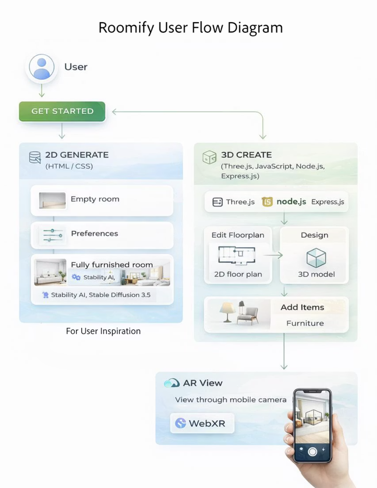

# ROOMIFY

> **From Empty Rooms to Beautiful Homes**

User-friendly interior designing in a 3D drag-and-drop workspace with Augmented Reality

---

## Problem Statement

Designing a house and arranging furniture is overwhelming for common people. There is a need for user-friendly interior design tools, similar to how Canva simplified graphic design.

**Existing solutions usually offer:**
- Either a simple UI, **or**
- A professional AR experience
- **Rarely both**

This is the gap **Roomify** addresses.

---

## System Architecture

<!-- Architecture Diagram Placeholder -->


---

## Feasibility & Scalability

- Convert the drag-and-drop interface into a **marketplace**
- Directly bridge users and furniture retailers
- Scale the platform so users can customize 3D models by uploading images of furniture

---

## Technology Stack

| Category | Technologies |
|----------|-------------|
| **Frontend** | React, Three.js |
| **Backend** | Python (FastAPI), REST APIs |
| **AI & ML** | Planned: an AI design agent (the earlier 2D image-generation demo is parked) |
| **3D & AR** | WebXR, Three.js, Blender |

---

## Project Structure

```
Roomify/
├── 3d_room/                 # 3D Room Designer & AR View
│   ├── example/             # Main 3D room designer interface
│   ├── ar_view/             # AR pages (served by backend/ over HTTPS)
│   ├── src/                 # TypeScript source files
│   └── lib/                 # Type definitions
├── backend/                 # FastAPI — catalogue, prices, designs, AR serving
│   ├── main.py
│   └── data/prices.db       # furniture price data
├── landing_page/            # Landing page
└── parked/                  # code that is no longer in use
    └── 2d_image_generation/ # Flask AI image-generation demo (parked)
```

---

## Implementation Guide

### Prerequisites

- **Node.js** (v14 or higher)
- **Python** (v3.8 or higher)
- **npm** or **yarn**
- **pip**

### 1. Clone the Repository

```bash
git clone https://github.com/yourusername/Roomify.git
cd Roomify
```

### 2. Setting Up the 3D Room Designer

```bash
# Navigate to 3d_room directory
cd 3d_room

# Install dependencies
npm install

# Start dev: Vite (:5173) + FastAPI (:8080, and AR over https :8002)
npm run dev
```

Open http://localhost:5173. `npm run build` makes a production build in `3d_room/dist/`
(`npm run preview` serves it on :4173, with FastAPI running).

### 3. The AR view

There is no separate AR server any more — the FastAPI backend serves `3d_room/ar_view/`
over HTTPS, which `npm run dev` starts for you on `https://<your-ip>:8002`. WebXR requires
HTTPS, so it needs a self-signed certificate. The keypair is **not** in the repo (it is
git-ignored) — generate it once after cloning, before `npm run dev` or `npm run ar`:

```bash
cd 3d_room/ar_view
openssl req -x509 -newkey rsa:2048 -nodes -days 3650 -keyout key.pem -out cert.pem -subj '/CN=roomify-dev'
```

Never commit `key.pem`.

Phone and computer must be on the same Wi-Fi; accept the certificate warning on the phone.
The same pages are on `http://localhost:8080` for desktop testing, without the warning.

### 4. Setting Up the Python Backend

The **catalogue / design / AR service** (FastAPI) is part of `npm run dev`:

```bash
cd backend
python3 -m venv venv
venv/bin/pip install -r requirements.txt
venv/bin/uvicorn main:app --port 8080 --reload   # or: cd ../3d_room && npm run backend
```

The old 2D image-generation demo (Flask) is parked in `parked/2d_image_generation/` and
is not part of the app.

---

## How to Use

### 3D Room Designer

1. **Open the Application**: run `npm run dev` in `3d_room/` and open http://localhost:5173 (serve over HTTP, not `file://`)
2. **Design Your Floor Plan**: 
   - Use the 2D view to draw room walls
   - Click and drag to create walls
   - Double-click to complete a room
3. **Add Furniture**:
   - Switch to 3D view
   - Browse the furniture catalog on the right panel
   - Drag and drop items into your room
4. **Customize**:
   - Click on items to select them
   - Resize, rotate, or delete items
   - Adjust wall textures and colors
5. **Export for AR**:
   - Save your design
   - Export to view in Augmented Reality

### AR View (Mobile)

1. **Start the servers**: `npm run dev` in `3d_room/` (the AR pages are served over HTTPS on :8002)
2. **Access on Mobile**: 
   - Connect your mobile device to the same network
   - Navigate to `https://your-ip:8002/ar-mobile.html`
3. **View Your Design**:
   - Point your camera at a flat surface
   - Your room design will appear in AR
   - Walk around to explore from different angles

---

## Contributing

1. Fork the repository
2. Create a feature branch (`git checkout -b feature/AmazingFeature`)
3. Commit your changes (`git commit -m 'Add some AmazingFeature'`)
4. Push to the branch (`git push origin feature/AmazingFeature`)
5. Open a Pull Request

**Thank You!**

We hope Roomify makes you more connected with your home.